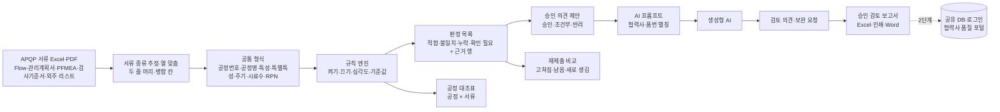

# APQP Smart Review — 초도품 APQP 제출서류 정합성 검증·승인 검토 지원 — 프로젝트 기획서

| 항목 | 내용 |
|---|---|
| 리포 | data10-02 |
| 제출자 | 이준호 |
| 직무·소속 | 부품품질팀 (회사명 생략) |
| 과정 | 현장 데이터 디지털화 전문가과정 2차수 |
| 작성일 | 2026-10-20 |
| 문서 상태 | 초안 v0.1 — 수강생 제출 자료 기반 |

---

## 1. 추진 배경과 현안

- 부품품질팀은 협력사가 초도품 승인을 위해 제출하는 APQP 서류(Flow Chart · 관리계획서 · PFMEA · 검사기준서 · 외주품 리스트)를 검토해 승인 여부를 정합니다.
- 서류는 Excel 또는 PDF 로 들어오고, 서류끼리 공정번호·공정명·관리항목·특별특성·검사 주기가 서로 맞는지를 사람이 눈으로 대조하는 것으로 보입니다(가정).
- 서류가 여러 개이고 행이 많아 누락·불일치를 빠뜨리기 쉽고, 검토자마다 보는 기준이 달라질 수 있습니다(가정).
- 반려 후 재제출을 받으면, 앞에서 지적한 것이 고쳐졌는지 다시 처음부터 확인해야 합니다(가정).

## 2. 목표

### 2.1 최종 목표

- 품번 하나의 APQP 서류 세트를 올리면 **문서 간 공정·관리항목 정합성 평가**가 자동으로 나오는 시스템
- **누락·불일치·확인 필요 사항 목록** — 어느 서류 몇 행이 근거인지 함께
- **승인 의견 제안**(승인 / 조건부 승인 / 반려)과 **APQP 승인 검토 보고서** 출력
- 재제출 때 앞 결과와 비교해 고쳐진 것·남은 것을 바로 보기
- 팀 공유, 같은 수강생의 과제 01(협력사 공정불량 Master Plan)과 「협력사 품질 포털」로 묶기 (장기)

### 2.2 1차 개발 목표

실제 서류와 대조 규칙을 받기 전이라, 1차는 **가상 서류 세트로 흐름 전체가 도는 브라우저 도구**를 만듭니다.

- Excel(여러 시트 통합 문서도) 업로드 → 서류 종류 추정 · 머리행·열 자동 연결 → 공통 형식(공정번호·공정명·특성·특별특성·관리/검사방법·주기·시료수·S/O/D/RPN)으로 정리
- 규칙 엔진(규칙마다 켜기·끄기·심각도·기준값) → 판정 목록·공정 대조표·적합률·승인 의견 제안
- AI 프롬프트로 보고서 문장 다듬기(반자동), 보고서 Excel·인쇄·Word, 재제출 비교
- 글자가 든 PDF 는 시범으로 읽음(스캔본은 2단계)

## 3. 보유 데이터

| 데이터 | 형태 | 규모·주기 | 비고(민감도 등) |
|---|---|---|---|
| Flow Chart | Excel 또는 PDF | 품번마다 1개 | 공정번호·공정명·공정 구분(외주 표시 포함)으로 가정 |
| 관리계획서(Control Plan) | Excel 또는 PDF | 품번마다 1개 | 공정번호·공정명·제품/공정 특성·특별특성·규격·평가측정방법·시료 크기·주기·관리방법. 두 줄 머리·병합 칸이 흔함 |
| PFMEA | Excel 또는 PDF | 품번마다 1개 | 공정·요구사항·고장형태·S·O·D·RPN·분류 |
| 검사기준서 | Excel 또는 PDF | 품번마다 1개 | 검사항목·특별특성·규격·검사방법·시료수·주기. 공정번호 열이 없을 수 있음 |
| 외주품 리스트 | Excel 또는 PDF | 품번마다 1개 | 외주 공정·외주처·품번 |
| 승인 검토 보고서 양식·과거 반려 사유 | 미상 | — | 보고서 칸 배치·규칙 보정에 필요 (10장 ③) |

제출 원문에 실제 서류 첨부는 없습니다. 협력사 이름·품번·외주처는 사내 정보라 외부 AI 에 보낼 때 별칭으로 가립니다. 1단계는 협력사 B · 품번 SMP-2041 의 가상 서류(1차 제출 + 2차 재제출)로 만듭니다.

## 4. 해결 방안 개요

| 단계 | 내용 |
|---|---|
| 수집 | 품번 하나의 서류 세트를 「검토 건」(협력사·품번·제출 차수)으로 올림 |
| 정리 | 시트 이름·열 이름으로 서류 종류 추정, 제목 줄 아래 머리행·두 줄 머리 찾기, 병합 칸 채우기, 공정번호 표기 통일(OP10·010 → 10) |
| 대조 | 규칙 8개(아래 5장) — 공정명·특성 이름은 띄어쓰기·부호·괄호 속을 무시한 「닮음」으로 짝지음 |
| 판단 | 지적마다 심각도(중대·경미), 중대·경미 건수로 승인 의견 제안 — 최종 결정은 검토자 |
| AI | 판정 사실만 담은 프롬프트로 검토 의견·보완 요청 문장을 받음 |
| 산출물 | 판정 목록, 공정 대조표, 승인 검토 보고서, 재제출 비교 |

## 5. 주요 기능

| 기능 | 설명 | 우선순위 |
|---|---|---|
| 서류 업로드·열 연결 | Excel·CSV(통합 문서 여러 시트도)를 브라우저에서 읽고 서류 종류·머리행·열을 자동 연결. 틀리면 직접 고르고, 고른 연결은 같은 양식에 다시 씀 | MVP |
| PDF 읽기 | 글자가 든 PDF 를 글자 위치로 표로 다시 맞춤(시범). 스캔본·DRM PDF 는 못 읽음 | MVP(시범) |
| 규칙 ① 필수 서류 제출 | 4종 + 외주 공정이 있으면 외주품 리스트 | MVP |
| 규칙 ② 공정번호 존재 일치 | Flow Chart 공정번호가 관리계획서·PFMEA 에 모두 있는지(이동·보관 등은 제외 설정), 반대로 Flow 에 없는 공정은 확인 필요 | MVP |
| 규칙 ③ 공정명 일치 | 같은 공정번호의 공정명 닮음(기준 80% 적합 · 50% 확인 필요) | MVP |
| 규칙 ④ PFMEA 고위험 → 관리계획서 | RPN ≥ 100 또는 S ≥ 9 항목이 관리계획서 같은 공정에 관리방법과 함께 있는지 | MVP |
| 규칙 ⑤ 특별특성 기호 일치 | 관리계획서·검사기준서의 기호가 같은지(◆=CC, ◇=SC 대응표) | MVP |
| 규칙 ⑥ 검사 항목 → 검사기준서 | 관리계획서 검사 공정 항목이 검사기준서에 있는지 | MVP |
| 규칙 ⑦ 검사 주기·시료수 일치 | 「매 로트」=「1회/LOT」, 「5개」=「5 EA」처럼 같은 뜻은 같게 비교 | MVP |
| 규칙 ⑧ 외주 공정 → 외주품 리스트 | Flow Chart 외주 공정이 리스트에 있는지 | MVP |
| 판정 목록·공정 대조표 | 근거(서류·행) 누르면 그 행 보기, 공정 × 서류 표 | MVP |
| 승인 의견 제안·검토자 결정 | 규칙 심각도로 제안, 검토자가 결정·의견·보완 요청 작성 | MVP |
| AI 보고서 문장 | 사실만 담은 프롬프트(별칭) → 답 붙여 넣기 → 검토 의견·보완 요청에 반영. 선택: OpenAI 호환 서버로 자동 보내기 | MVP(반자동) |
| 승인 검토 보고서 | Excel(요약·판정 목록·공정 대조표·재제출 비교·규칙 설정·서류 데이터), 인쇄/PDF, Word | MVP (양식은 10장 ③ 받은 뒤 맞춤) |
| 재제출 비교 | 같은 협력사·품번의 앞 차수와 고쳐짐·남음·새로 생김 | MVP |
| 공유·포털 | 팀 공유 DB·로그인, 과제 01 과 협력사 품질 포털 | 확장(2단계) |

## 6. 기대 산출물

1. **정합성 검토 도구(브라우저)** — 업로드, 규칙 대조, 판정 목록, 공정 대조표
2. **누락·불일치·확인 필요 목록** — 근거 서류·행 포함
3. **APQP 승인 검토 보고서** — 승인 의견 제안 + 검토자 결정, Excel·인쇄·Word
4. **재제출 비교** — 앞 지적이 고쳐졌는지
5. **공유·협력사 품질 포털** — 2단계

## 7. 기술 구성

| 과정 도구 | 이 프로젝트에서 쓰는 곳 |
|---|---|
| 암묵지 자산화·전략기획 | 「정합하다」고 보는 대조 규칙, 반려 기준, 과거 반려 사유를 꺼내 적기 |
| 코랩(Python)·바이브코딩 | 서류 정리·대조 규칙 시험, 브라우저 도구 제작 — 1단계의 중심 |
| 생성형 AI | 검토 의견·보완 요청 문장 (1단계는 프롬프트 복사 반자동, 선택적으로 자동 보내기) |
| RAG·자동화 | 과거 반려 사유·승인 사례를 근거로 한 의견 추천, 스캔 PDF 글자 읽기 (확장) |

**개발 형태(권장)**

- 1단계는 **설치 없이 브라우저에서 도는 정적 웹 도구**입니다. 서류를 브라우저 안에서만 읽고 대조하므로 협력사 APQP 서류가 밖으로 나가지 않습니다. 대조·판정은 AI 없이 규칙으로 동작합니다.
- AI 에는 **도구가 대조한 사실(판정·근거 행)만** 보내고, **협력사·외주처 이름과 품번은 「업체1」「품목1」 같은 별칭으로 가립니다(기본).** 서류 원본은 보내지 않습니다.
- 승인 의견은 **제안**이며, 최종 결정은 검토자가 보고서에 적습니다.
- 화면 틀·부품은 과제 01(data10-07)과 같게 만들어, 2단계에서 한 포털의 메뉴로 합치기 쉽게 했습니다.

## 8. 개발 단계

### 1단계 — 지금 개발 가능한 부분

실제 서류가 없어도 **제출 원문의 서류 5종 이름과 APQP 서류의 일반 구성**으로 흐름 전체를 만들 수 있습니다. 가상 서류로 먼저 만들고, 실제 세트를 받으면 열 이름 사전·규칙 기준값만 맞춥니다.

- 검토 건(협력사·품번·구분·제출 차수·제출일) 만들기, 재제출 등록
- Excel·CSV·통합 문서 업로드, 서류 종류 추정, 머리행·두 줄 머리·병합 칸, 열 직접 고르기(기억), 정규화 미리보기
- 글자가 든 PDF 시범 읽기(pdf.js, 브라우저 안에서만)
- 규칙 8개 — 켜기·끄기·심각도·기준값 설정
- 판정 목록(필터·근거 행 보기), 공정 대조표, 적합률, 승인 의견 제안
- 승인 의견(검토자 결정·의견·보완 요청), AI 프롬프트·답 읽기, 보고서 Excel·인쇄·Word
- 검토 이력·재제출 비교, JSON 백업
- 가상 1차 제출에는 결함 5가지(공정 하나 PFMEA 누락 · 특별특성 기호 불일치 · 고RPN 항목이 관리계획서에 없음 · 검사기준서 주기 불일치 · 외주 공정 리스트 누락)를 일부러 넣고, 2차 재제출은 고친 세트로 만들어 규칙과 비교가 제대로 잡는지 확인합니다.

### 2단계

- 실제 서류 세트로 열 이름 사전·두 줄 머리 보정, 회사가 정한 대조 규칙·반려 기준 반영
- 지금 쓰시는 승인 검토 보고서 양식에 맞춘 출력
- 스캔 PDF 글자 읽기(OCR), DRM 조건에 맞춘 사용 방법
- 공유 DB(Supabase)와 로그인 — 팀이 같은 검토 건 보기, 검토 이력 공유
- **협력사 품질 포털**: 과제 01(공정불량 Master Plan)과 한 포털의 메뉴로 묶기(협력사 → APQP 서류 / 공정불량·개선계획)

### 3단계

- 과거 반려 사유·승인 사례를 근거로 한 의견 추천(RAG)
- 협력사가 직접 올리고 보완 요청을 받는 제출 창구

## 9. 기대 효과

- **검토 시간 단축** — 서류를 올리면 공정·항목 대조가 바로 나옵니다.
- **빠뜨림 감소·기준 일관화** — 같은 규칙으로 모든 공정·항목을 대조하고, 근거 행이 남습니다.
- **재제출 확인 부담 감소** — 앞 지적이 고쳐졌는지 바로 보입니다.
- **보고서 작성 부담 감소** — 판정·제안·AI 문장에서 시작해 검토자가 다듬습니다.

제출 자료에는 정량 수치가 없어 이 문서도 수치를 적지 않습니다.

## 10. 수강생 확인 목록

패들릿 댓글로 요청드린 것입니다. 받으면 1단계 도구의 열 이름 사전·규칙·보고서를 맞춥니다.

1. **한 품번의 APQP 서류 한 세트** — Flow Chart · 관리계획서 · PFMEA · 검사기준서 · 외주품 리스트. 실제 열 이름·머리 구성·시트 구성을 확인합니다. 협력사명·품번은 가려서 보내셔도 됩니다.
2. **「정합하다」고 보는 대조 규칙 3~5개** — 예: Flow Chart 공정번호가 관리계획서·PFMEA 에 모두 있어야 함. 지금 시작 규칙 8개(5장)와 기준값(RPN 100 · S 9 · 공정명 닮음 80%)을 맞춥니다.
3. **지금 쓰는 승인 검토 보고서 양식과 과거 반려 사유** — 보고서 칸 배치와 규칙 심각도(무엇이 반려 사유인지)를 맞춥니다.
4. **엑셀·PDF 비율과 문서보안(DRM) 조건** — PDF 가 많으면 읽기를 강화하고, 스캔본이면 OCR 이 필요합니다. DRM 이 걸린 파일은 브라우저가 읽을 수 없어 사용 방법을 정해야 합니다.

추가로 확인하고 싶은 것(답을 받으면 반영):

5. 특별특성 기호 체계(◆/◇, CC/SC, 고객사 기호 등)
6. 외부 AI(ChatGPT 등) 사용 허용 여부, 사내 허용 AI 가 있는지

## 부록. 제출 원문 요약

| 출처 | 파일·게시물 | 내용 |
|---|---|---|
| 패들릿 게시물 (2차수) | 「APQP Smart Review」 — `docs/source/패들릿_접수_원문.md` | 직무·소속(부품품질팀), 현안(초도품 APQP 제출서류 정합성 검증·승인 의사결정 지원), 보유 데이터(Flow Chart·관리계획서·PFMEA·검사기준서·외주품 리스트, 엑셀 또는 PDF), 기대 산출물 3종(정합성 평가, 누락·불일치·확인 필요 목록, 승인 검토 보고서) |
| 같은 수강생 | 과제 01 — 협력사 공정불량 Master Plan (data10-07) | 별도 리포. 2단계에서 협력사 품질 포털의 메뉴로 묶을 수 있음 |
